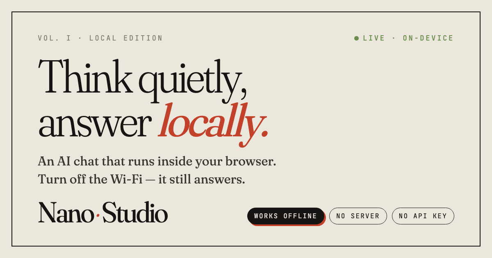

# Nano Studio

A chat playground for **Gemini Nano**, the AI model built into Chrome. It runs on your own machine: no server, no API key, and it keeps answering with the Wi-Fi off.

**Live demo:** https://utkarshchakrwarti.github.io/Nano-Studio-X-Chrome/



## What it does

- **Runs on-device.** Prompts and replies never leave your computer.
- **Works offline.** The model is local, and a service worker caches the page and fonts, so it opens with no connection. It can also be installed as an app from Chrome's address bar.
- **Fast.** The model is loaded before you finish typing, one session is reused across turns, and streaming renders at most once per frame.
- **Remembers the conversation.** The chat is saved on your device and survives reloads, tab switches and setting changes.
- **Stop and regenerate.** Stop a reply mid-sentence (`Esc`), or regenerate the last answer.
- **Personas and creativity.** Set a system prompt (or pick a preset) and choose how adventurous the model is.
- **Memory meter.** Shows how much of the model's context window the conversation has used.
- **Markdown replies.** Code blocks with a copy button, tables, lists, links and quotes.
- **Voice input.** Uses Chrome's on-device speech recognition when it is installed. Otherwise Chrome transcribes speech through its online service, and the mic button says so.

## Requirements

| | |
|---|---|
| Browser | Desktop Chrome 148 or newer (Chrome 138–147 with the two flags below) |
| OS | Windows 10/11, macOS 13+, Linux, or ChromeOS on Chromebook Plus |
| Disk | About 22 GB free on the drive that holds your Chrome profile |
| Hardware | A GPU with more than 4 GB of VRAM, or 16 GB of RAM and 4+ CPU cores |

Phones, Safari and Firefox cannot run it yet. The first run downloads the model once (unmetered connection needed); after that everything is offline.

On Chrome 138–147, enable these and relaunch:

- `chrome://flags/#prompt-api-for-gemini-nano` → **Enabled**
- `chrome://flags/#optimization-guide-on-device-model` → **Enabled BypassPerfRequirement**

## Run it locally

Chrome does not give the model to `file://` pages, so the page has to be served. The bundled server has no dependencies and listens on `127.0.0.1` only, so nothing else on your network can reach it.

```bash
git clone https://github.com/UtkarshChakrwarti/Nano-Studio-X-Chrome.git
```

```bash
cd Nano-Studio-X-Chrome
```

```bash
node serve.mjs
```

Open http://localhost:8000. To use another port: `node serve.mjs 3000`.

No Node? Python does the same job:

```bash
python3 -m http.server 8000 --bind 127.0.0.1
```

## Host it

It is a static site with no build step. Push to GitHub and enable **Settings → Pages → Deploy from branch → `main`**, or drop the folder on any static host that serves HTTPS.

Visitors get updates automatically: the service worker serves the cached page instantly, fetches the new one in the background, and shows an "Update ready" button.

## How it works

Everything lives in [`index.html`](index.html). The extra files only add offline support and local serving.

| File | Purpose |
|---|---|
| `index.html` | The whole app: markup, styles and logic |
| `sw.js` | Service worker: caches the page and fonts for offline use |
| `manifest.webmanifest`, `icon*` | Lets Chrome install it as an app |
| `serve.mjs` | Local server bound to `127.0.0.1` |
| `og.png` | Link-preview image |

The core of it is a few lines of the [Prompt API](https://developer.chrome.com/docs/ai/prompt-api):

```js
const session = await LanguageModel.create({
  initialPrompts: [{ role: 'system', content: 'You are a terse editor.' }],
});
for await (const chunk of session.promptStreaming('Explain recursion like I am five')) {
  console.log(chunk);
}
```

### Session handling

- **The transcript is the source of truth.** Model sessions are disposable. Whenever one has to be replaced, it is rebuilt from the saved transcript with `initialPrompts`, so the model never loses the conversation.
- **One warm session.** It is created as soon as the page loads (when the model is already on disk) and reused for every turn.
- **Rebuilt only when needed**: when the system prompt or creativity changes, after a stop or an error, or after five idle minutes. Rebuilds run in the background ahead of the next message.
- **Context window.** The meter reads `session.contextUsage / session.contextWindow`. When a conversation outgrows the window, the oldest turns are dropped and the chat says so.

### Streaming renderer

- Chunks are batched with `requestAnimationFrame`, so the page renders at most once per frame however fast tokens arrive.
- Finished blocks are rendered once and frozen. Only the block still being written is re-rendered.
- All model output is HTML-escaped before any markup is produced.
- The view follows new text only while you are at the bottom. Scroll up and it stays put.

### Creativity setting

On ordinary web pages Chrome no longer accepts raw `temperature` / `topK`. It takes a preset `samplingMode`, and only on origins enrolled in the *Sampling Parameters* origin trial. The slider sends `samplingMode` (and falls back to `temperature` / `topK` where those still exist). Without the trial Chrome ignores it and uses the model default; the app shows a note when it cannot confirm the setting was applied.

To make the slider effective on your hosted copy, register your origin at https://developer.chrome.com/origintrials and add the token to `<head>`:

```html
<meta http-equiv="origin-trial" content="YOUR_TOKEN">
```

## Privacy

- Text prompts and replies are processed by the model on your device.
- The chat and settings are stored in your browser's `localStorage`. **New chat** clears the conversation.
- Fonts are loaded from Google Fonts on the first visit, then served from the local cache.
- Voice input is on-device only when Chrome's local speech model is installed; see above.
